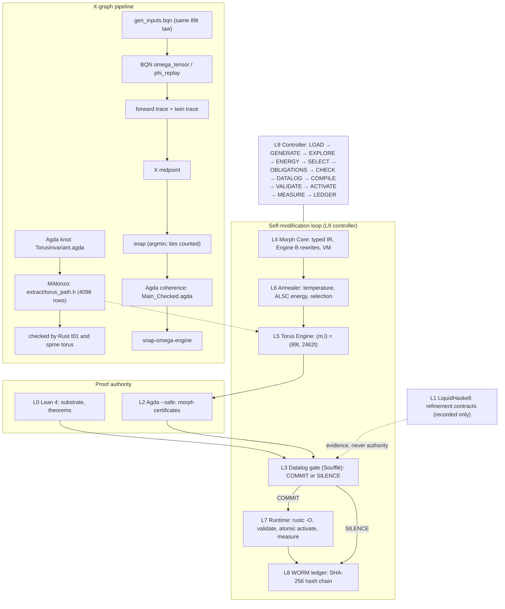
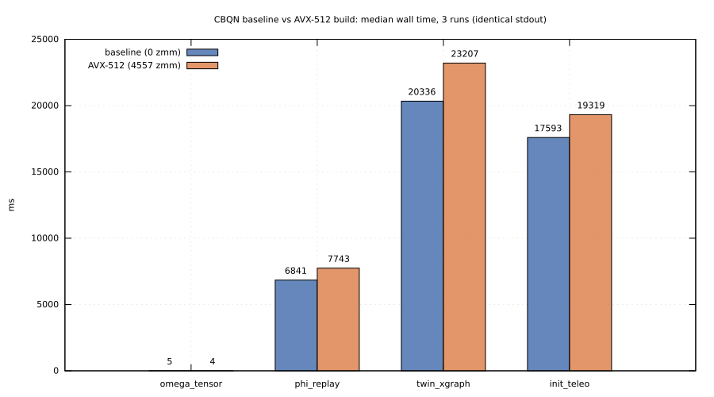
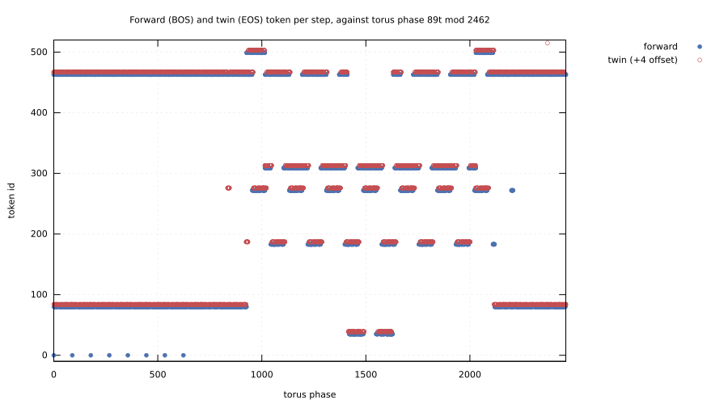
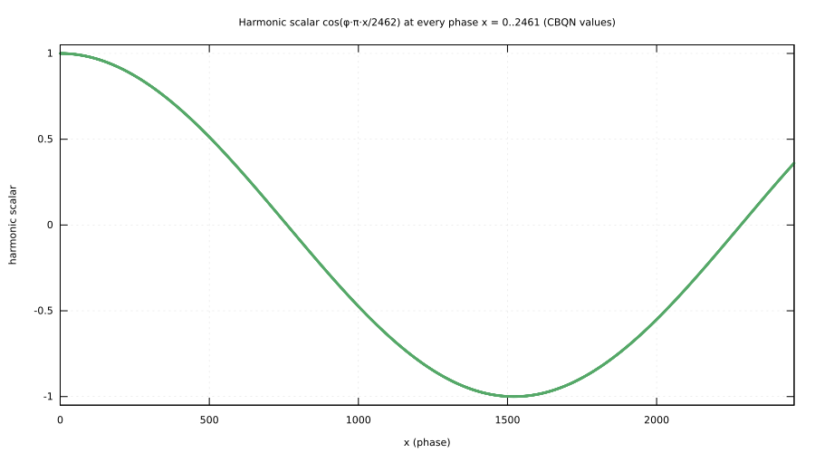
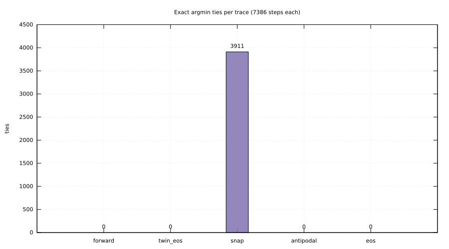
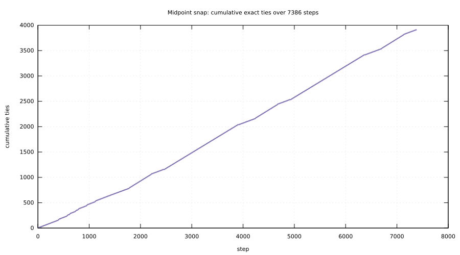
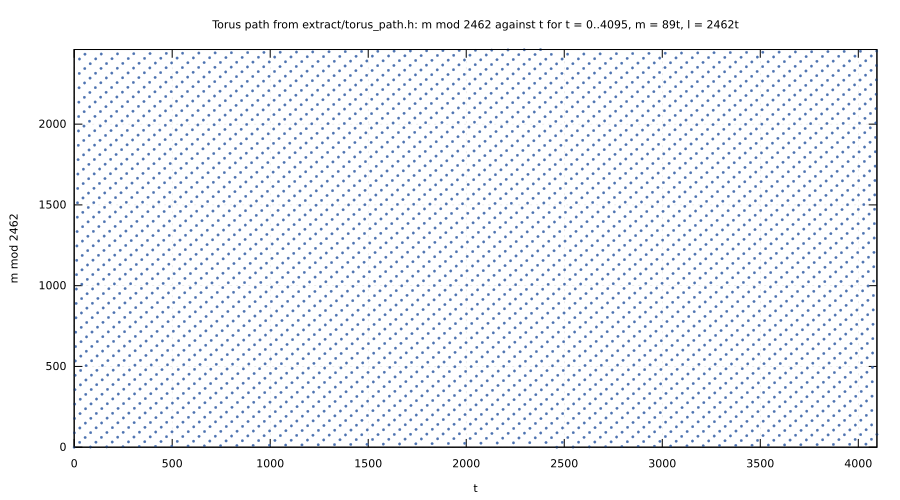

<!-- SPDX-License-Identifier: AGPL-3.0-only OR LicenseRef-SnapKitty-Opaque-1.0 -->
<!-- Copyright (C) 2026 Ahmad Ali Parr / SnapKitty Research Lab -->

# SOVEREIGN PROOF MORPH ENGINE

[](LICENSE)
[](lean)
[](agda)
[](docs/bqn-avx512.md)
[](docs/measurements/tests.txt)
[](datalog/gate.dl)
[-lightgrey)](haskell)

**A program that rewrites itself only with a proof.**

We built a machine that changes its own code, and it is not allowed to do so
because it feels like it. It needs a theorem.

Each self-modification is a proposal. The annealer proposes. The torus
picks a coordinate on the 89/2462 knot. Agda checks the certificate, and a
Datalog gate counts the evidence. Only then does the runtime swap the binary,
atomically, and write it into a hash-chained ledger that never forgets.

If any step is missing, the answer is not "probably fine". The answer is
**SILENCE**. The gate says COMMIT or it says nothing.

Some things we refuse to fake:

- **No `sorry`.** Every `_Checked` Lean file prints only `propext`,
  `Classical.choice` and `Quot.sound`.
- **No postulates.** Every new or checked Agda module has zero postulates, and
  the certificate modules and every generated certificate are checked under `--safe`.
- **Failures stay visible.** The originals are kept as they were written,
  failures and all. Every error line is in this README.
- **Every number below was measured on this machine** and is in
  [docs/measurements/](docs/measurements). GPU is left blank because we did not measure one.
- **RH is `OPEN_CRUX` (ADR-055).** Nothing here proves it. Pending work is
  `SILENCE_PENDING` (ADR-062).
- **Authority stays with the provers.** LiquidHaskell and BQN never become
  proof authority. Lean and Agda decide; everything else is evidence or
  measurement.

Contractivity here is not a Banach contraction. It is a discrete monotone
fixed point: once the annealer finds nothing lower, the target equals the
source, the torus does not advance, and the gate falls silent. The demo hits
that point at generation 2.

*Built by team NO reply, SnapKitty Research Lab.*

---

## The stack



Be clear about one thing. The BQN programs do **not** read `torus_path.h`.
Their inputs come from [bqn/checked/gen_inputs.bqn](bqn/checked/gen_inputs.bqn),
which uses the same 89t law. The extracted table is checked by
[rust/tests/t01_torus.rs](rust/tests/t01_torus.rs) and by `spme torus`.
CBQN is an interpreter: the `.bqn` files are interpreted, not compiled to
machine code. AVX-512 applies to the interpreter binary.

## Layer status

| layer | implementation | status (measured) |
|---|---|---|
| L0 Lean 4 | [lean/](lean) | 12 checked/new files exit 0: 10 have 0 `sorry` and standard axioms only, and the 2 `_Inconsistent` files derive `False` from the original axioms; 6 originals fail (below) |
| L1 LiquidHaskell | [haskell/Contracts.hs](haskell/Contracts.hs), [rust/src/liquid.rs](rust/src/liquid.rs) | SAFE; the negative file is UNSAFE at lines 10, 15, 21 |
| L2 Agda | [agda/](agda), [agda/Morph/](agda/Morph), [rust/src/agda.rs](rust/src/agda.rs) | 11 new/checked modules exit 0 with 0 postulates; 3 originals fail |
| L3 Datalog | [datalog/gate.dl](datalog/gate.dl), [rust/src/gate.rs](rust/src/gate.rs) | 7/7 gate tests pass; fails closed |
| L4 Morph Core | [rust/src/ir.rs](rust/src/ir.rs), [rewrite.rs](rust/src/rewrite.rs), [vm.rs](rust/src/vm.rs) | 10/10 IR/rewrite/reference tests pass |
| L5 Torus Engine | [rust/src/torus.rs](rust/src/torus.rs), [extract/torus_path.h](extract/torus_path.h) | 4096 rows; phase over t = 0..2461 is a permutation: true |
| L6 Annealer | [rust/src/anneal.rs](rust/src/anneal.rs), [rust/src/energy.rs](rust/src/energy.rs) | 4/4 tests pass; replay is identical |
| L7 Runtime | [rust/src/native.rs](rust/src/native.rs), [rust/src/runtime.rs](rust/src/runtime.rs) | demo: 69/69 native agree with the VM |
| L8 WORM Ledger | [rust/src/ledger.rs](rust/src/ledger.rs) | `ledger OK: 4 records`; tamper/truncation detected (g13) |
| L9 Controller | [rust/src/controller.rs](rust/src/controller.rs), [rust/src/main.rs](rust/src/main.rs) | lifecycle, fault rollback and replay: 3/3 pass |

Details: [docs/architecture.md](docs/architecture.md), [docs/verification-report.md](docs/verification-report.md).

## Per-file checker results

The originals are byte for byte as written, plus the licence header. The fixes
are in `_Checked`. Source: [docs/measurements/lean.txt](docs/measurements/lean.txt),
[docs/measurements/agda.txt](docs/measurements/agda.txt).

### Lean 4.35.0 + Mathlib

| original | exit | exact error | checked variant | exit |
|---|---|---|---|---|
| [SnapUnique.lean](lean/SnapUnique.lean) | 1 | `13:80` and `17:77: unexpected token 'variable'; expected 'lemma'`; `29:26`, `18:20`, `35:24`, `35:56`, `35:36`, `47:2`, `47:48`, `47:36`, `47:16: don't know how to synthesize implicit argument`; `89:5: unknown tactic` | [SnapUnique_Checked.lean](lean/SnapUnique_Checked.lean) | 0 |
| [SnapUniqueFixed.lean](lean/SnapUniqueFixed.lean) | 1 | `3:0: object file … of module Mathlib.Order.Bounds does not exist` | [SnapUniqueFixed_Inconsistent.lean](lean/SnapUniqueFixed_Inconsistent.lean) (derives `False` from its axiom) | 0 |
| [HarmonicAperiodic.lean](lean/HarmonicAperiodic.lean) | 1 | `3:0: object file … of module Mathlib.Data.Real.Irrational does not exist`; 2 `sorry` (lines 63, 65), 2 axioms | [HarmonicAperiodic_Checked.lean](lean/HarmonicAperiodic_Checked.lean) | 0 |
| [TwinAnchor.lean](lean/TwinAnchor.lean) | 1 | `3:0: object file … of module Mathlib.Data.Real.Irrational does not exist` | [TwinAnchor_Checked.lean](lean/TwinAnchor_Checked.lean) | 0 |
| [SovereignSuperposition.lean](lean/SovereignSuperposition.lean) | 1 | `41:2: Tactic 'split' failed`; `86:6: omega could not prove the goal` (counterexample `89*a - 2462*b ≥ 1`) | [SovereignSuperposition_Checked.lean](lean/SovereignSuperposition_Checked.lean) | 0 |
| [XREX_ALSC.lean](lean/XREX_ALSC.lean) | 1 | `20:2: unexpected token 'variable'; expected 'lemma'`; `47:2: Tactic 'split' failed` | [XREX_ALSC_Checked.lean](lean/XREX_ALSC_Checked.lean) | 0 |
| — | | | [SnapUnique_Inconsistent.lean](lean/SnapUnique_Inconsistent.lean) (derives `False` from `x_graph_injective`) | 0 |
| — | | | [XGraph.lean](lean/XGraph.lean), [PhaseNormalization.lean](lean/PhaseNormalization.lean), [Audit.lean](lean/Audit.lean), [EngineAArith.lean](lean/EngineAArith.lean), [EngineAUnsupported.lean](lean/EngineAUnsupported.lean) | 0 |

Axioms in the originals: `phi_irr` and `cos_eq_one_iff` (HarmonicAperiodic);
`x_graph_injective` and `exists_min_dist` (SnapUnique); `exists_min_dist`
(SnapUniqueFixed); `toNat_add_le` (SovereignSuperposition, XREX_ALSC);
`sqrt_five_irr` (TwinAnchor). Two of them are provably inconsistent: see the
`_Inconsistent` files.

### Agda 2.6.4.3

| original | exit | exact error | checked variant | exit |
|---|---|---|---|---|
| [CompleteCoherence.agda](agda/CompleteCoherence.agda) | 42 | `15,13: Parse error` | [CompleteCoherence_Checked.agda](agda/CompleteCoherence_Checked.agda) | 0 |
| [ExperientialFunctor.agda](agda/ExperientialFunctor.agda) | 42 | `79,7-26: The following names are declared but not accompanied by a definition: postulate-coherence`; `87,7-37: Δt + 88 * Δt != Δt * 89 of type ℕ` | [ExperientialFunctor_Checked.agda](agda/ExperientialFunctor_Checked.agda) | 0 |
| [Main.agda](agda/Main.agda) | 42 | fails on import: `CompleteCoherence.agda:15,13: Parse error` | [Main_Checked.agda](agda/Main_Checked.agda) | 0 |
| — | | | [TorusInvariant.agda](agda/TorusInvariant.agda), [ExtractTorusPath.agda](agda/ExtractTorusPath.agda), [PhiHarmonics.agda](agda/PhiHarmonics.agda), [Morph/IR](agda/Morph/IR.agda), [Morph/Subst](agda/Morph/Subst.agda), [Morph/Rewrite](agda/Morph/Rewrite.agda), [Morph/Topology](agda/Morph/Topology.agda), [Morph/TorusBridge](agda/Morph/TorusBridge.agda) | 0, 0 postulates |

### `#print axioms`

| theorem | axioms |
|---|---|
| `XGraph.eventually_periodic`, `XGraph.period_multiple`, `XGraph.midpoint_tie` | propext, Classical.choice, Quot.sound |
| `XGraph.merge` | propext |
| `PhaseNormalization.coprime_89_2462`, `winding_closes`, `sampling_collision` | propext, Classical.choice, Quot.sound |
| `PhaseNormalization.roundtrip`, `roundtrip'`, `phase_injective_on`, `phase_period`, `collision_iff` | propext, Quot.sound |
| `XREX_ALSC_Checked.toNat_add_le` | propext |
| `XREX_ALSC_Checked.alsc_fp16_safe` | propext, Quot.sound |
| `SovereignSuperposition_Checked.alsc_fp16_safe`, `extract_verified_agent` | propext, Quot.sound |
| `HarmonicAperiodic_Checked.harmonic_never_loops`, `bqn_harmonic_never_loops` | propext, Classical.choice, Quot.sound |
| `SnapUnique_Checked.exists_min_dist`, `snap_unique`, `snap_kernel_unique`, `midpoint_tie` | propext, Classical.choice, Quot.sound |
| `ConsciousOmega_Checked.sqrt_five_irr`, `antipode_anchor_is_irrational` (TwinAnchor_Checked) | propext, Classical.choice, Quot.sound |
| `SnapUniqueInconsistent.inconsistent` : False | …, `x_graph_injective` (original axiom) |
| `SnapUniqueFixedInconsistent.inconsistent` : False | …, `exists_min_dist` (original axiom) |

### Engine A: Lean → IR → Agda

| theorem | result |
|---|---|
| scale_id, poly_eq, twice_id, mix_eq | PROVED (Agda), Lean/IR agreement 4/4, LH SAFE |
| lit_arith | PROVED (Agda), agreement 1/1, LH SAFE |
| pick_id | UNPROVED: `Engine B normal forms differ after 4 rounds: lhs (if (fst #0) (snd #0) (snd #0)) vs rhs (snd #0)` |
| [EngineAUnsupported.lean](lean/EngineAUnsupported.lean) | half, fact, exists_succ, and_stmt, compose all REJECTED with a line number (division, function types, ∃, ∧) |

## Benchmarks: CBQN base vs AVX-512 (Singeli)

CBQN b62079a, gcc 14.2.0, CPU flag `avx512f` = 1, inputs N = 7386, V = 512,
D = 64. Each figure is the median of 3 runs, and stdout is identical on both
builds. Source: [docs/measurements/bqn.txt](docs/measurements/bqn.txt),
[docs/measurements/cbqn-zmm.txt](docs/measurements/cbqn-zmm.txt),
[docs/bqn-avx512.md](docs/bqn-avx512.md).

| program | base median ms | AVX-512 median ms | outputs |
|---|---|---|---|
| omega_tensor | 5 | 4 | identical |
| phi_replay | 6841 | 7743 | identical |
| twin_xgraph | 20336 | 23207 | identical |
| init_teleo | 17593 | 19319 | identical |
| GPU | | | |

On these interpreted workloads the AVX-512 build is slower on three of the four.

| build | `objdump -d BQN \| grep -c zmm` |
|---|---|
| `make o3` (base, benchmarked) | 0 |
| `make o3n` (fresh rebuild) | 572 (binary differs from the benchmarked one) |
| `make o3n f="-mprefer-vector-width=512"` (fresh rebuild) | 4557, byte-identical to the benchmarked AVX-512 binary |



## BQN outputs, loops and ties

| program | measurement |
|---|---|
| omega_tensor | phase 0..2461, a permutation of the first 2462; delta = 89 at 7386/7386 steps; coherent 3712; checksum 404587591 |
| phi_replay | harmonic min/max ¯0.9999996584275549 / 1; 8 distinct tokens; longest run 12; argmin ties 0; cycle μ = 1447, λ = 2462; checksum 35857419 |
| twin_xgraph | forward μ = 1447, λ = 2462; twin (EOS) μ = 1, λ = 2462; bidirectional 8 distinct; equals forward at 5425 and twin at 5427 steps; forward ≠ twin at 3920 steps; checksum 791181031 |
| init_teleo | m = 16; resonance ¯0.8253408053890465; not a vocabulary row; antipodal and EOS both μ = 1, λ = 2462; agree at 7385 steps, merge at step 1; checksum 42951646 |

| trace | exact argmin ties |
|---|---|
| phi_replay forward | 0 |
| twin_xgraph forward | 0 |
| twin_xgraph twin (EOS) | 0 |
| twin_xgraph snap (X midpoint) | 3911 |
| init_teleo antipodal | 0 |
| init_teleo EOS | 0 |

Every trace has period λ = 2462, which is exactly the phase period. That is what
[lean/XGraph.lean](lean/XGraph.lean) predicts: a deterministic map on a finite
state space is eventually periodic, and the period is a multiple of the
phase period 2462. `XGraph.midpoint_tie` proves that the X midpoint is exactly
equidistant from both rows, so its snap is decided by tie-breaking: 3911 ties measured.

| | |
|---|---|
|  |  |
|  |  |
|  | |

The figures come from [scripts/figures.sh](scripts/figures.sh) and
[scripts/figures.gp](scripts/figures.gp) (gnuplot). Their data comes from
[bqn/checked/dump_traces.bqn](bqn/checked/dump_traces.bqn), the extracted
table and `bqn.txt`.

### snap-omega-engine (Agda → MAlonzo, real output)

```text
$ ./agda/snap-omega-engine
CONSCIOUSNESS Ω (checked): coherent PhenomenalState qualia-intensity=1000 resonance-phase=2492 (coherence-inv proved: norm ≤ 2462 ≤ m)
exit 0
```

### spme torus

```text
torus table: 4096 rows, header sha256 7eea5d0f773c98652bc7cd0b37c9f9402d29cc1297aaa52c88234f309324984a; phase over t=0..2461 is a permutation: true
```

## Tests

`cargo test --release -- --test-threads=1` ([docs/measurements/tests.txt](docs/measurements/tests.txt)):

| suite | covers | passed | failed |
|---|---|---|---|
| [t01_torus](rust/tests/t01_torus.rs) | gcd, winding, extracted table, corrupted table, phase permutation, collisions | 5 | 0 |
| [t03_anneal](rust/tests/t03_anneal.rs) | deterministic replay, acceptance rule, cooling | 4 | 0 |
| [t05_ir](rust/tests/t05_ir.rs) | parse/typecheck/eval, overflow traps, every pass preserves semantics, Haskell reference, native | 10 | 0 |
| [t07_checkers](rust/tests/t07_checkers.rs) (56.35 s) | Lean Engine A, Agda accept/reject, LiquidHaskell, invalid certificates | 6 | 0 |
| [t10_gate](rust/tests/t10_gate.rs) | complete evidence, each missing obligation, SYNTH fail-closed, LH not authority, broken rules | 7 | 0 |
| [t12_lifecycle](rust/tests/t12_lifecycle.rs) (113.46 s) | faults → rollback, chain, replay, tamper, truncation, invalid migrations | 3 | 0 |
| **total** | | **35** | **0** |

## End-to-end demo

Source: [scripts/demo.sh](scripts/demo.sh) → [docs/measurements/demo.txt](docs/measurements/demo.txt), seed 7386, on [examples/gen0.morph](examples/gen0.morph).

| generation | decision | facts |
|---|---|---|
| load | COMMIT | v0000; vm_instr = 290 |
| 1 | COMMIT | anneal proposed 400, accepted 259, improved 9; E 26.934648456566887 → 21.24485415833575; torus t = 167, coord [14863, 411154], phase 91; Agda certificate 7342 ms; native 69 inputs, agree_vm 69, agree_reference 40, reference_trapped 29; vm_instr 290 → 100; native median 3358770 → 2901746 ns per 10⁶ calls; v0001 |
| 2 | REJECT, gate SILENCE | improved = 0, target = source, t stays 167: `no_semantic_preservation; topology_invalid`; v0001 stays active |
| 3 | REJECT, gate SILENCE | same fixed point |

`verify-ledger` gives `ledger OK: 4 records`. `replay --recheck` re-checks every
certificate and reproduces every anneal (`replay: OK (4 records)`). `ref-check`
gives `inputs=69 agree=41 rust_overflow_excluded=28 disagree=0`. That differs
from the 40/29 split reported by native validation in generation 1. The two
counts come from different checks, and both are reported as measured.

## Notebook

[notebooks/end_to_end.ipynb](notebooks/end_to_end.ipynb) uses a bash kernel (no Python code) and has 24 cells.
It was executed with `jupyter nbconvert --execute` and all its outputs are real. To regenerate it, run
[scripts/make_notebook.sh](scripts/make_notebook.sh) (bash + jq).

## Not in this repository

The spec names these substrate paths, and none of them exist:
`lean-substrate/src/Substrate.lean`, `packages/lh-theorems/src/Veneer/Contractivity.hs`,
`packages/datalog`, `packages/probe-gate`. The layers are implemented in
[lean/](lean), [haskell/](haskell), [datalog/](datalog) and [rust/](rust) instead.

Toolchain blockers for the originals:

- This Mathlib moved `Mathlib.Data.Real.Irrational` to `Mathlib.NumberTheory.Real.Irrational`.
- `Mathlib.Order.Bounds` is now `Mathlib.Order.Bounds.Defs`.

The originals are left unedited, so they fail on import.

## Documentation

- [docs/architecture.md](docs/architecture.md): L0–L9 mapped to files
- [docs/verification-report.md](docs/verification-report.md): checker results, the gate, the TCB, the ledger trust model
- [docs/torus-invariant.md](docs/torus-invariant.md): the 89/2462 knot, MAlonzo extraction
- [docs/harmonics.md](docs/harmonics.md): cos(φπx/2462), PhiHarmonics
- [docs/bqn-checked.md](docs/bqn-checked.md): what changed in `bqn/checked/` and why
- [docs/bqn-avx512.md](docs/bqn-avx512.md): Singeli build, zmm counts, timings
- [docs/measurements/](docs/measurements): raw outputs behind every number
- [docs/figures/](docs/figures): gnuplot figures

## Repository map

Every tracked file and folder:

- **[repository root](.)**:
  [.gitignore](.gitignore)
  [LICENSE](LICENSE)
  [LICENSE-AGPL-3.0](LICENSE-AGPL-3.0)
  [LICENSE-SnapKitty-Opaque-1.0](LICENSE-SnapKitty-Opaque-1.0)
  [Makefile](Makefile)
- **[agda/](agda)**:
  [CompleteCoherence.agda](agda/CompleteCoherence.agda)
  [CompleteCoherence_Checked.agda](agda/CompleteCoherence_Checked.agda)
  [ExperientialFunctor.agda](agda/ExperientialFunctor.agda)
  [ExperientialFunctor_Checked.agda](agda/ExperientialFunctor_Checked.agda)
  [ExtractTorusPath.agda](agda/ExtractTorusPath.agda)
  [Main.agda](agda/Main.agda)
  [Main_Checked.agda](agda/Main_Checked.agda)
  [Makefile](agda/Makefile)
  [Makefile.checked](agda/Makefile.checked)
  [PhiHarmonics.agda](agda/PhiHarmonics.agda)
  [TorusInvariant.agda](agda/TorusInvariant.agda)
- **[agda/Morph/](agda/Morph)**:
  [IR.agda](agda/Morph/IR.agda)
  [Rewrite.agda](agda/Morph/Rewrite.agda)
  [Subst.agda](agda/Morph/Subst.agda)
  [Topology.agda](agda/Morph/Topology.agda)
  [TorusBridge.agda](agda/Morph/TorusBridge.agda)
- **[bqn/](bqn)**:
  [init_teleo.bqn](bqn/init_teleo.bqn)
  [omega_tensor.bqn](bqn/omega_tensor.bqn)
  [phi_replay.bqn](bqn/phi_replay.bqn)
  [twin_xgraph.bqn](bqn/twin_xgraph.bqn)
- **[bqn/checked/](bqn/checked)**:
  [dump_traces.bqn](bqn/checked/dump_traces.bqn)
  [gen_inputs.bqn](bqn/checked/gen_inputs.bqn)
  [init_teleo_checked.bqn](bqn/checked/init_teleo_checked.bqn)
  [lib.bqn](bqn/checked/lib.bqn)
  [omega_tensor_checked.bqn](bqn/checked/omega_tensor_checked.bqn)
  [phi_replay_checked.bqn](bqn/checked/phi_replay_checked.bqn)
  [twin_xgraph_checked.bqn](bqn/checked/twin_xgraph_checked.bqn)
- **[datalog/](datalog)**:
  [gate.dl](datalog/gate.dl)
- **[docs/](docs)**:
  [architecture.md](docs/architecture.md)
  [bqn-avx512.md](docs/bqn-avx512.md)
  [bqn-checked.md](docs/bqn-checked.md)
  [harmonics.md](docs/harmonics.md)
  [torus-invariant.md](docs/torus-invariant.md)
  [verification-report.md](docs/verification-report.md)
- **[docs/figures/](docs/figures)**:
  [avx512_timings.svg](docs/figures/avx512_timings.svg)
  [harmonic_scalars.svg](docs/figures/harmonic_scalars.svg)
  [snap_ties_cumulative.svg](docs/figures/snap_ties_cumulative.svg)
  [tie_counts.svg](docs/figures/tie_counts.svg)
  [torus_path.svg](docs/figures/torus_path.svg)
  [twin_trace_tokens.svg](docs/figures/twin_trace_tokens.svg)
- **[docs/measurements/](docs/measurements)**:
  [agda.txt](docs/measurements/agda.txt)
  [bqn.txt](docs/measurements/bqn.txt)
  [cbqn-zmm.txt](docs/measurements/cbqn-zmm.txt)
  [demo.txt](docs/measurements/demo.txt)
  [lean.txt](docs/measurements/lean.txt)
  [snap-omega-engine.txt](docs/measurements/snap-omega-engine.txt)
  [tests.txt](docs/measurements/tests.txt)
  [torus.txt](docs/measurements/torus.txt)
- **[examples/](examples)**:
  [gen0.morph](examples/gen0.morph)
- **[extract/](extract)**:
  [gen_torus_path.sh](extract/gen_torus_path.sh)
  [torus_path.h](extract/torus_path.h)
- **[haskell/](haskell)**:
  [Contracts.hs](haskell/Contracts.hs)
  [Ref.hs](haskell/Ref.hs)
- **[haskell/negative/](haskell/negative)**:
  [ContractsWrong.hs](haskell/negative/ContractsWrong.hs)
- **[lean/](lean)**:
  [Audit.lean](lean/Audit.lean)
  [EngineAArith.lean](lean/EngineAArith.lean)
  [EngineAUnsupported.lean](lean/EngineAUnsupported.lean)
  [HarmonicAperiodic.lean](lean/HarmonicAperiodic.lean)
  [HarmonicAperiodic_Checked.lean](lean/HarmonicAperiodic_Checked.lean)
  [PhaseNormalization.lean](lean/PhaseNormalization.lean)
  [SnapUnique.lean](lean/SnapUnique.lean)
  [SnapUniqueFixed.lean](lean/SnapUniqueFixed.lean)
  [SnapUniqueFixed_Inconsistent.lean](lean/SnapUniqueFixed_Inconsistent.lean)
  [SnapUnique_Checked.lean](lean/SnapUnique_Checked.lean)
  [SnapUnique_Inconsistent.lean](lean/SnapUnique_Inconsistent.lean)
  [SovereignSuperposition.lean](lean/SovereignSuperposition.lean)
  [SovereignSuperposition_Checked.lean](lean/SovereignSuperposition_Checked.lean)
  [TwinAnchor.lean](lean/TwinAnchor.lean)
  [TwinAnchor_Checked.lean](lean/TwinAnchor_Checked.lean)
  [XGraph.lean](lean/XGraph.lean)
  [XREX_ALSC.lean](lean/XREX_ALSC.lean)
  [XREX_ALSC_Checked.lean](lean/XREX_ALSC_Checked.lean)
  [lake-manifest.json](lean/lake-manifest.json)
  [lakefile.toml](lean/lakefile.toml)
  [lean-toolchain](lean/lean-toolchain)
- **[notebooks/](notebooks)**:
  [end_to_end.ipynb](notebooks/end_to_end.ipynb)
- **[rust/](rust)**:
  [Cargo.lock](rust/Cargo.lock)
  [Cargo.toml](rust/Cargo.toml)
- **[rust/src/](rust/src)**:
  [agda.rs](rust/src/agda.rs)
  [anneal.rs](rust/src/anneal.rs)
  [controller.rs](rust/src/controller.rs)
  [energy.rs](rust/src/energy.rs)
  [engine_a.rs](rust/src/engine_a.rs)
  [eval.rs](rust/src/eval.rs)
  [gate.rs](rust/src/gate.rs)
  [ir.rs](rust/src/ir.rs)
  [json.rs](rust/src/json.rs)
  [ledger.rs](rust/src/ledger.rs)
  [lib.rs](rust/src/lib.rs)
  [liquid.rs](rust/src/liquid.rs)
  [main.rs](rust/src/main.rs)
  [native.rs](rust/src/native.rs)
  [parse.rs](rust/src/parse.rs)
  [refmodel.rs](rust/src/refmodel.rs)
  [rewrite.rs](rust/src/rewrite.rs)
  [runtime.rs](rust/src/runtime.rs)
  [sexp.rs](rust/src/sexp.rs)
  [sha256.rs](rust/src/sha256.rs)
  [torus.rs](rust/src/torus.rs)
  [typecheck.rs](rust/src/typecheck.rs)
  [vm.rs](rust/src/vm.rs)
- **[rust/src/bin/](rust/src/bin)**:
  [certcheck.rs](rust/src/bin/certcheck.rs)
- **[rust/tests/](rust/tests)**:
  [common.rs](rust/tests/common.rs)
  [t01_torus.rs](rust/tests/t01_torus.rs)
  [t03_anneal.rs](rust/tests/t03_anneal.rs)
  [t05_ir.rs](rust/tests/t05_ir.rs)
  [t07_checkers.rs](rust/tests/t07_checkers.rs)
  [t10_gate.rs](rust/tests/t10_gate.rs)
  [t12_lifecycle.rs](rust/tests/t12_lifecycle.rs)
- **[scripts/](scripts)**:
  [bqn_avx512.sh](scripts/bqn_avx512.sh)
  [check_agda.sh](scripts/check_agda.sh)
  [check_lean.sh](scripts/check_lean.sh)
  [demo.sh](scripts/demo.sh)
  [figures.gp](scripts/figures.gp)
  [figures.sh](scripts/figures.sh)
  [make_notebook.sh](scripts/make_notebook.sh)

## Build and run

Requirements, as measured here: Lean 4.35.0 (elan) with Mathlib; Agda 2.6.4.3 with the
standard library; Soufflé 2.5; Rust 1.85; GHC 9.6 (for MAlonzo and the reference
model); LiquidHaskell 0.9.6.3.1 with z3 (L1 only; set `LH_GHC`, `LH_PKGDB`, `Z3_DIR`); CBQN
(base, plus an AVX-512 build made with `make o3n f="-mprefer-vector-width=512"`);
gnuplot; jq; and for the notebook, Jupyter with the bash kernel.

```sh
cd sovereign-proof-morph-engine
make build ref          # Rust engine (spme, certcheck) + Haskell reference model
make torus              # Agda → MAlonzo → extract/torus_path.h
make lean               # every lean/*.lean with #print axioms (recorded: docs/measurements/lean.txt)
make agda               # every agda/*.agda (recorded: docs/measurements/agda.txt)
make agda-engine        # agda/snap-omega-engine via Main_Checked
make lh                 # LiquidHaskell: Contracts SAFE, ContractsWrong UNSAFE
make datalog            # Soufflé gate tests (t10_gate)
make test               # cargo test --release (35 tests)
make bqn BQN=/path/to/CBQN/BQN
make bqn-avx512 BQN=/path/to/CBQN/BQN BQN_AVX512=/path/to/CBQN-avx512/BQN
make demo               # scripts/demo.sh (output: docs/measurements/demo.txt)
make figures            # docs/figures/*.svg and *.png (gnuplot)
make notebook           # execute notebooks/end_to_end.ipynb in place (NBVENV=jupyter venv)
scripts/make_notebook.sh  # regenerate the notebook source (bash + jq)

rust/target/release/spme load examples/gen0.morph --work build/w --seed 7386
rust/target/release/spme run --work build/w --seed 7386 --generations 3
rust/target/release/spme verify-ledger --work build/w
rust/target/release/spme replay --work build/w --recheck
```

Licensed `AGPL-3.0-only OR LicenseRef-SnapKitty-Opaque-1.0`. See [LICENSE](LICENSE),
[LICENSE-AGPL-3.0](LICENSE-AGPL-3.0), [LICENSE-SnapKitty-Opaque-1.0](LICENSE-SnapKitty-Opaque-1.0).

Copyright (C) 2026 Ahmad Ali Parr / SnapKitty Research Lab. Built by team NO reply, SnapKitty Research Lab.
